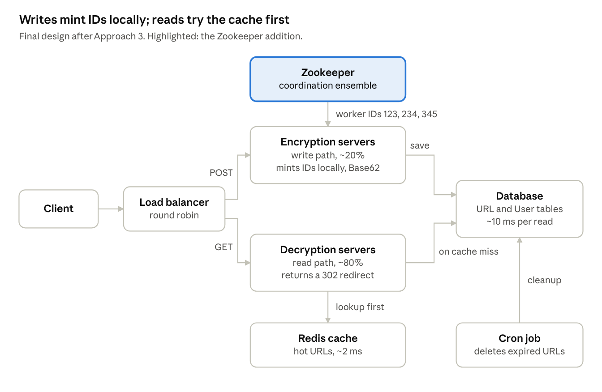

# URL Shortener System Design

A 30-minute talk script on designing a URL shortener like Bit.ly.

## Talk plan

The talk runs 30 minutes in eight parts. It follows the whiteboard from requirements, through three ways to generate IDs, to the final design.

| # | Part | Minutes | Clock |
| --- | --- | --- | --- |
| 1 | Intro and problem | 2 | 0:00–2:00 |
| 2 | Requirements | 4 | 2:00–6:00 |
| 3 | Entities and APIs | 3 | 6:00–9:00 |
| 4 | High-level design | 3 | 9:00–12:00 |
| 5 | Approach 1: hashing | 4 | 12:00–16:00 |
| 6 | Approach 2: Redis counter | 5 | 16:00–21:00 |
| 7 | Approach 3: Zookeeper and Snowflake ID | 6 | 21:00–27:00 |
| 8 | Expiry, redirects, wrap-up | 3 | 27:00–30:00 |

Lines marked **Say** are suggested speaking lines. Keep the backup Q&A at the end for spare minutes.

## 1. Intro (2 min)

Bit.ly turns a long URL into a short one and redirects anyone who opens the short link back to the original.

Example: `https://www.facebook.com/anindya.s.dasgupta/` becomes `http://bit.ly/4kyLcpo`.

**Say:** "It looks simple, but at billions of URLs we must solve three things: unique ID generation, fast redirects and high availability."

Why short URLs matter:

- Character limits in SMS and tweets
- Clean, shareable links and QR codes
- Click analytics for marketers

## 2. Requirements (4 min)

The system must create and resolve short URLs for 100M daily users within about 200 ms, favouring availability over consistency.

### Functional

1. Create a short URL from a long URL.
   - Optional: a custom alias, such as `bit.ly/mano-resume`.
   - Optional: an expiration date.
2. Redirect the user from the short URL to the original URL.

### Non-functional

- **Low latency:** about 200 ms for both URL creation and redirect.
- **Scale:** 100M daily active users and 1B stored URLs.
- **Uniqueness:** two long URLs never share a short URL.
- **CAP:** availability over consistency; eventual consistency is acceptable.

**Say:** "If a new link takes a second to reach every replica, nobody is hurt. If redirects go down, every link shared on the internet breaks. So we choose availability."

### Quick numbers

- 7 Base62 characters (a–z, A–Z, 0–9) give 62⁷ ≈ 3.5 trillion codes, far more than 1B.
- Storage: 1B URLs × about 500 bytes ≈ 500 GB.
- Reads far outnumber writes; the whiteboard uses an 80/20 split.

## 3. Entities and APIs (3 min)

Three entities and two endpoints cover the whole product: one write path and one read path.

**Entities:** short URL, long URL, user.

| Endpoint | Body or parameter | Returns | Path |
| --- | --- | --- | --- |
| `POST /v1/url` | `longURL`, `customURL?`, `expirationDate?` | the short URL | Write |
| `GET /v1/url/{shortURL}` | the short code | a 301/302 redirect to the long URL | Read |

**Say:** "POST is the write path and GET is the read path. Keep that split in mind, because later we scale the two separately."

## 4. High-level design (3 min)

The first design is client → server → database. It works for a demo, but it leaves open how the server makes a unique short code.

**Draw:** Client → Server (generates the short URL) → Database.

| Table | Columns |
| --- | --- |
| URL | `shortURL` (primary key), `longURL`, `expirationDate`, `customURL` |
| User | user metadata |

- **Create:** the client sends the long URL; the server makes a code, saves it and returns the short URL.
- **Redirect:** the client sends the code; the server looks it up and redirects to the long URL.

**Say:** "The interesting box is *generate the short URL*. How do we make the code unique, short and fast? Let's try three approaches."

## 5. Approach 1: hashing (4 min)

Hashing the long URL and keeping the first 6–7 characters is simple, but truncated hashes collide.

**Logic:** `sha1(longUrl)` → keep the first 6–7 characters → return that as the short URL.

**Show the whiteboard example:**

```
facebook.com/anindya.s.dasgupta/  →  9191c0 37d0c5f4408f0caf5c3cd39edd
amazon.in/                        →  9191c0 37d0c5f4408f0caf5c3cd39e3r3
```

**Say:** "Both hashes start with `9191c0`. After truncating, two different URLs get the same short code. That's a collision."

**Handling a collision:** check the DB; if the code exists, rehash with a salt or take the next characters, then check again.

**Latency from the whiteboard:** hashing takes about 1 ms and each DB call about 5 ms. One attempt costs about 16 ms, and each collision repeats it (16 ms + 16 ms + …). Collisions grow as the table fills.

| Pros | Cons |
| --- | --- |
| Simple to build | Collisions after truncation |
| Same long URL can map to the same code | Extra DB round trips per collision |
|  | Latency becomes unpredictable |

## 6. Approach 2: Redis counter (5 min)

A global counter in Redis gives every new URL a unique number, so collisions disappear. The counter itself then becomes the bottleneck.

**Idea:** each new URL takes the next counter value, and we Base62-encode it. For example, counter 1,000,000 encodes to `4c92`.

**Draw the whiteboard architecture:**

```
Client → Load Balancer (round robin, ~5 ms)
  ├─ Encryption servers (write, ~20%) → Redis counter (2–3 ms) → Database (10 ms)
  └─ Decryption servers (read, ~80%)  → Redis cache (2 ms) → Database on a miss
```

1. **Split read and write services.** Reads are about 80% of traffic, so decryption servers scale on their own.
2. **Redis `INCR` is atomic.** Two servers never receive the same number.
3. **Cache the read path.** A Redis hit takes about 2 ms; a miss reads the DB in about 10 ms and fills the cache.

**Say:** "Collisions are gone. But every write now waits on one Redis box."

**Problems that set up Approach 3:**

- The Redis counter is a single point of failure.
- Every write needs a network call to Redis, which caps throughput.
- If Redis restarts without persistence, the counter resets and duplicates appear.

## 7. Approach 3: Zookeeper and Snowflake ID (6 min)

Zookeeper gives each write server its own worker ID or counter range. Servers then mint unique IDs locally, with no network call per request.

### What Zookeeper is (2 min)

**Say:** "Zookeeper is a distributed, open-source coordination service. It handles configuration, naming, synchronization, distributed locking and group membership."

- It stores data as a tree of **znodes**, like a file system: `/` → `/app1`, `/app2` → `/app1/p_1`, `/app1/p_2`, `/app1/p_3`.
- **Ephemeral znodes** vanish when their server dies, so Zookeeper always knows which servers are alive.
- It runs as a cluster (an ensemble), so it is not itself a single point of failure.

### How we use it (4 min)

**Draw:** Zookeeper assigns a worker ID to each encryption server, for example 123, 234 and 345.



Writes go to encryption servers that mint IDs using a worker ID from Zookeeper. Reads try Redis first and fall back to the database.

**Option A, counter ranges:** Zookeeper hands each server a block of numbers, such as 1–1M and 1M–2M. Each server counts in memory and asks for a new block when it runs out. A crashed server loses its unused numbers, which is fine with trillions available.

**Option B, Snowflake ID** (Twitter's scheme): each server builds a 64-bit ID locally.

| Bits | Part | What it gives |
| --- | --- | --- |
| 1 | Sign | always 0 |
| 41 | Timestamp in ms | 2⁴¹ / (365 × 24 × 60 × 60 × 1000) ≈ 69.73 years |
| 10 | Worker ID from Zookeeper | up to 1,024 servers |
| 12 | Sequence | 2¹² = 4,096 IDs per ms per server |

**Say:** "The timestamp keeps IDs unique over time, the worker ID across machines, and the sequence within one millisecond. No coordination per request, so it scales horizontally."

**Trade-offs to mention:**

- A 64-bit Snowflake ID is about 11 Base62 characters, longer than counter ranges give.
- Snowflake trusts server clocks; a clock moving backward can create duplicates.

## 8. Expiry, redirects and wrap-up (3 min)

A cron job cleans expired links, and a 302 redirect keeps click analytics. That completes the design.

### Expiration

- A **cron job** periodically deletes or archives expired URLs; their codes can be reused.
- The read path also checks `expirationDate` and returns 404 or 410 for an expired link.

### 301 vs 302 redirect

|  | 301 Permanent | 302 Temporary |
| --- | --- | --- |
| Browser caching | Yes; later clicks skip our server | No; every click reaches our server |
| Server load | Lower | Higher |
| Click analytics | Lost | Kept |

**Say:** "Bit.ly's business is analytics, so it uses 302. If we only cared about load, we'd use 301."

### Custom URL

Check whether the alias already exists in the DB. If it does, return **409 Conflict**.

### Closing summary (30 seconds)

**Say:** "We started with client, server and database. Hashing gave us collisions. A Redis counter fixed collisions but became a bottleneck. Zookeeper with counter ranges or Snowflake IDs gave unique IDs without per-request coordination. We split reads from writes, cached hot URLs in Redis, chose availability over consistency, cleaned expired links with cron and used 302 redirects to keep analytics."

## Backup Q&A

Use these if time remains or the audience asks.

| Question | Answer |
| --- | --- |
| Same long URL submitted twice? | Return the existing code (needs an index on `longURL`) or create a new one per user. Bit.ly creates one per user. |
| Which database? | A NoSQL key-value store such as Cassandra or DynamoDB: simple key lookups, horizontal scaling. |
| How to prevent abuse? | Rate limit per user or IP, and check URLs against malware lists. |
| Can people guess short URLs? | Sequential counters are guessable; shuffle the Base62 alphabet or add a random offset. |
